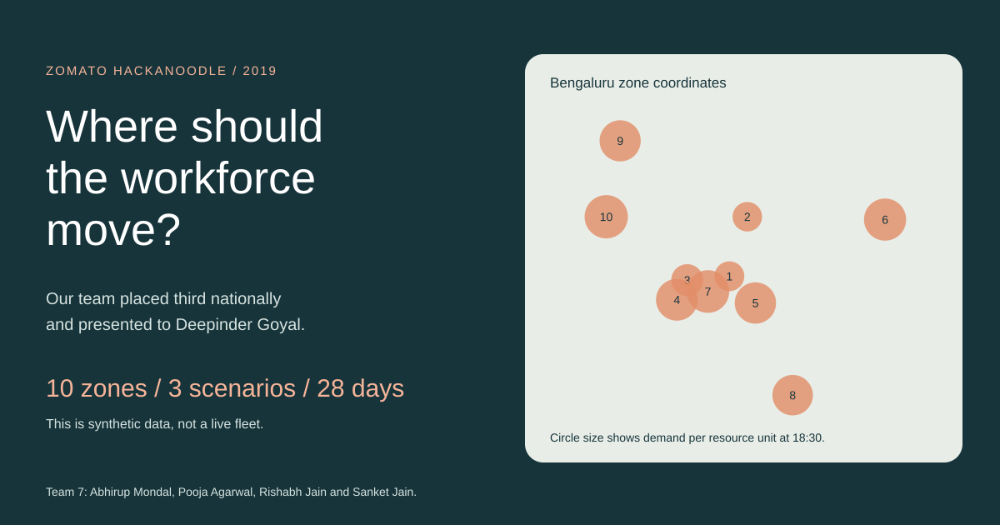
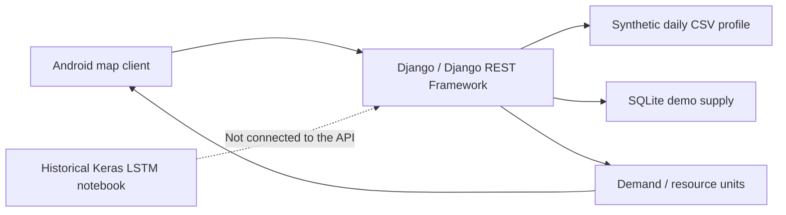

# Demand-Supply Workforce Heatmaps in 2019



**Our team placed third nationally at the 2019 Zomato Hackanoodle Scale Hackathon and presented the prototype to Deepinder Goyal.**

The idea was to help a workforce compare demand with available supply across nearby zones. The Android client showed a heatmap, and the decision to relocate remained voluntary.

> This is a team hackathon prototype built with synthetic data. The 2026 review repairs the local demonstration and adds an interactive report. It does not establish real demand, fleet size, earnings or production impact.

## Explore the report

- Read [the interactive report](https://rishabhjain9196.github.io/reports/workforce-heatmap-2019/) on the portfolio website.
- Open [the interactive HTML report](docs/index.html) locally, or serve this repository with `python -m http.server 8000 --bind 127.0.0.1` and visit `http://127.0.0.1:8000/docs/`.
- Compare three scenarios on a Bengaluru basemap, change the time and inspect all ten zone values.
- Explore daily profiles, hourly demand, a four-week synthetic sequence and simple forecast baselines.
- Transfer resource units between zones to see both sides of the supply trade-off.
- Download [the 4,320 chart rows](docs/profiles.csv).

The report is self-contained. Its scripts, styles and cached map are local, and no backend is required.

## What the data supports

| Artifact | Contents | Interpretation |
| --- | --- | --- |
| [Daily profiles](backend/dev/data/) | Monday, Sunday and New Year each have 144 ten-minute rows and ten demand columns. | These are synthetic scenarios, not observations from dated service logs. |
| [Training sequence](ML%20Model/SyntheticData2.csv) | There are 4,032 rows and ten features, equivalent to 28 days. | The historical notebook trains on this constructed sequence. |
| [Original SQLite snapshot](backend/dev/db.sqlite3) | Ten zone definitions, 492 resource units and two driver-location records are present. | Resource units are demo weights, not a verified driver count. |
| [Training notebook](ML%20Model/Zomato_LSTM.ipynb) | A ten-unit LSTM uses a one-step look-back, 0.5 dropout and ten outputs. | It trains on the full sequence and contains no held-out evaluation. |
| [Presentation](documentation/Presentation.pptx) | The team describes the proposed product, scoring rule and architecture. | Proposed benefits are not measured outcomes. |

- The score is `synthetic demand / max(resource units, 1)`. It is not an order probability.
- Profiles are aligned by clock label and zone ID. The New Year file starts at noon; its labels are not silently shifted to midnight.
- A new 2026 check compares rolling one-step baselines on the final week:
  - The previous-interval baseline has a mean absolute error of **14.04**.
  - The previous-day baseline has a mean absolute error of **19.01**.
  - The previous-week baseline has a mean absolute error of **11.89**.
- Errors cover 10,080 synthetic target values. The repeated weekly construction favours seasonal baselines. These are **not LSTM evaluation results** or evidence about real demand.

## Architecture and current status



| Component | Status after the 2026 review |
| --- | --- |
| CSV-backed API | It runs locally on Python 3.12, Django 5.2 and DRF 3.16. Regression tests cover scoring, validation, time lookup and supply conservation. |
| Static report | It uses HTML, CSS, vanilla JavaScript and SVG. Data export uses Python's standard library. Pillow prepares the cached map image. |
| Android client | Source defects were repaired, but the legacy Instant App project has not been built or run in the review environment. Java and the Android SDK are unavailable there. |
| Keras experiment | The original notebook and saved weights are retained as historical artifacts. Current model compatibility and held-out model quality have not been verified. |

The backend does not load TensorFlow or call the saved LSTM. The unfinished inference endpoint returns HTTP 501 rather than a successful empty response.

## Run the local API

Use a new virtual environment. Do not use the previously committed macOS environment.

```powershell
python -m venv .venv
.\.venv\Scripts\python.exe -m pip install -r backend\dev\requirements.txt
Set-Location backend\dev
..\..\.venv\Scripts\python.exe manage.py migrate
..\..\.venv\Scripts\python.exe manage.py loaddata demo_blocks
..\..\.venv\Scripts\python.exe manage.py runserver 127.0.0.1:8000
```

On macOS or Linux, use `.venv/bin/python` instead of `.venv\Scripts\python.exe`.

- A separate, ignored `demo.sqlite3` holds local state. The historical `db.sqlite3` is not modified.
- Loading `demo_blocks` restores the ten original zones and the two original demo-driver positions.
- The API is an unauthenticated local demonstration. Do not expose it as a public service.
- An ephemeral Django key is generated unless `DJANGO_SECRET_KEY` is supplied. Set that environment variable if a stable local admin session is needed.

### Request examples

```text
GET /heatmap/get_heatmap?scenario=monday&time=18:30
POST /heatmap/update_location
Content-Type: application/json

{"id": 2, "latitude": 12.9279, "longitude": 77.6271}
```

- Scenarios are `monday`, `sunday` and `new-year`. The default remains `new-year`.
- Without a time query, the demo uses the current Asia/Kolkata clock time. Minutes round up to the next ten-minute boundary; an exact boundary is unchanged.
- Responses include named zones, demand, resource units, scores and a denominator-floor flag. The original comma-separated Android payload is also retained.
- Existing drivers transfer units only when their nearest zone changes. ID 1 has the historical weight of seven; other IDs have a weight of ten.
- Registering a new ID adds its weight once. Repeated same-zone updates do not add supply.
- Coordinates are rounded to four decimal places. The legacy model supports longitude only within `-99.9999` to `99.9999`; this is a Bengaluru demo, not a global location service.
- Missing setup or invalid profiles return HTTP 503. Invalid requests return HTTP 400. Insufficient origin supply returns HTTP 409.

## Reproduce and test

From the repository root:

```powershell
python scripts\build_report_data.py
python -m unittest discover -s scripts -p "test_*.py"
Set-Location backend\dev
..\..\.venv\Scripts\python.exe manage.py check
..\..\.venv\Scripts\python.exe manage.py makemigrations --check --dry-run
..\..\.venv\Scripts\python.exe manage.py test heatmap
```

- The data exporter reads the archived database in read-only mode, records source hashes and regenerates the report data, CSV download, cover and demo fixture.
- The cached basemap and projection metadata are checked in. Rebuilding only that image requires Pillow and network access: run `python scripts\build_map.py`, then rebuild the report data.
- The repaired daily generator uses a fixed seed, preserves time columns, validates intervals and refuses to overwrite an existing file:

```powershell
python "ML Model\Synthetic Data\generateData.py" --output new-profile.csv --seed 42
```

- This generator uses a 10% standard deviation around the selected mean profile. The separate historical training notebook uses 20% plus integer offsets. Neither generator is a model of observed geographic demand.

## Android source repairs

- Removed the compile typo, random relocation and substring-based JSON parsing.
- Added permission handling, map-readiness checks, location-listener cleanup, connection timeouts and explicit error messages.
- Refreshes the heatmap only after a successful location update. It uses demo driver ID 2 and the structured API response.
- Reads the Maps key from `GOOGLE_MAPS_API_KEY` rather than a committed key.
- Defaults to `http://10.0.2.2:8000`, the emulator's host address. Override it with the Gradle property `-PapiBaseUrl=...` when necessary.
- The project still uses SDK 26 and the retired `com.android.feature` plugin. These source repairs are not a modern Android migration.

Previously committed keys remain in Git history. If they were active, revoke or restrict them through their providers. Removing them from current source does not erase the history.

## Limits and conclusion

- The prototype shows how demand and supply can be combined into a visible, voluntary decision aid.
- The current matching rule uses straight coordinate distance. It does not account for road access, traffic, travel costs or zone boundaries.
- The experiment does not model several drivers moving towards the same hotspot.
- Real deployment would require reliable demand and availability data, proper held-out forecasting evaluation, movement costs and a controlled test of service outcomes.
- The supported achievement is a nationally placed team prototype. There is no evidence here of production deployment or measured business impact.

## Team 7: Throttling-Error

- Abhirup Mondal.
- Pooja Agarwal.
- Rishabh Jain.
- Sanket Jain.

The report credits the team without assigning unverified individual subsystem ownership.

## Map attribution

The cached basemap uses standard OpenStreetMap tiles for one Bengaluru view. Map data and cartography are copyright [OpenStreetMap contributors](https://www.openstreetmap.org/copyright). The report includes visible attribution. This current basemap is geographic context, not a historical 2019 road snapshot. Zone coordinates come from the project's original database.
